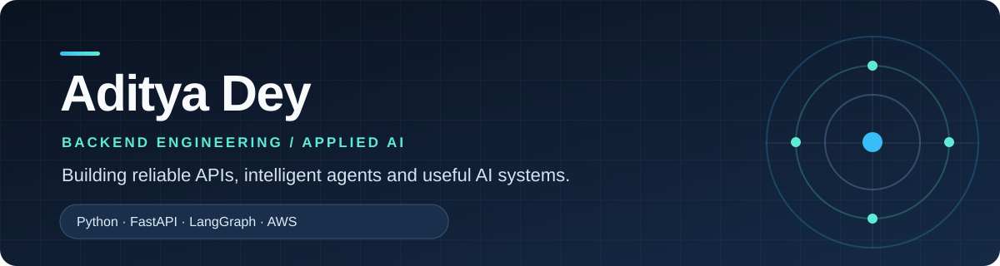

  
  

    
  

  
<strong>Backend Developer – AI</strong> · Kolkata, India

  

    <a href="https://adithash.in">Portfolio</a> &nbsp;·&nbsp;
    <a href="https://www.linkedin.com/in/aditya-dey-b533681b8/">LinkedIn</a> &nbsp;·&nbsp;
    <a href="mailto:adithash@proton.me">Email</a> &nbsp;·&nbsp;
    <a href="https://github.com/AditHash?tab=repositories">Repositories</a>
  

### About me

I build backend services and applied AI systems that turn complex workflows into dependable software. My work spans **Python APIs, LLM-powered applications, retrieval-augmented generation (RAG), agent orchestration, and document intelligence**.

I enjoy the engineering behind AI products: designing clean interfaces, connecting tools and data, building guardrails around actions, and making systems maintainable beyond the proof-of-concept stage.

### What I focus on

- **Backend engineering:** REST APIs, asynchronous workflows, data modeling, integrations, and production-oriented architecture.
- **Applied AI:** LLM applications, RAG pipelines, structured information extraction, tool-using agents, and model integration.
- **Reliable execution:** Permission-aware automation, human approval for sensitive actions, containerized services, and AWS deployments.

### Selected projects

| Project | What it demonstrates | Stack |
| :--- | :--- | :--- |
| **[SalesDig](https://github.com/AditHash/salesdig)** | Company research and sales intelligence application with workspace-aware data, AI-assisted insights, and vector-backed report retrieval. | TypeScript, Node.js, Express, React, PostgreSQL, pgvector |
| **[Edge Code Harness](https://github.com/AditHash/edge-harness-cli)** | Terminal coding agent with policy-gated tools, approval flows, sandboxed execution, resumable sessions, and MCP support. | Python, Strands, Amazon Bedrock, SQLite, MCP |
| **[DevDesk A2A](https://github.com/AditHash/a2a-sample-project)** | Two independently hosted LangChain agents communicating through the Agent2Agent protocol for bug triage and solution suggestions. | Python, LangChain, A2A, FastAPI |
| **[Computer-Use MCP Server](https://github.com/AditHash/computer-use-mcp-server)** | *In progress:* permission-aware Windows computer observation tools for system status, windows, monitors, and opt-in screenshots. | Python, MCP, Windows |

**Also exploring:** [OctoDig](https://github.com/AditHash/octodig-agent), an agentic research platform currently under development, and real-time voice AI experiments.

### Engineering toolkit

| Area | Technologies |
| :--- | :--- |
| **Languages** | Python, TypeScript / JavaScript, C++ |
| **Backend** | FastAPI, Flask, Node.js, Express, REST APIs, WebSockets |
| **AI & agents** | LangChain, LangGraph, Deep Agents, Amazon Bedrock, RAG, MCP, A2A |
| **Data** | PostgreSQL, pgvector, MongoDB, Redis |
| **Infrastructure** | AWS, Docker, Linux, Nginx, GitHub Actions |

I also study **data structures and algorithms in C++** and explore **Rust** for systems programming.

### Certifications

- **AWS Certified Generative AI Developer – Professional** (2026)
- **AWS Certified Machine Learning Engineer – Associate** (2024)
- **AWS Certified AI Practitioner** (2024)
- **AWS Certified Cloud Practitioner** (2024)
- **MongoDB SI Associate** (2025)

### Recognition

**Rising Star – AI** and **AI Innovation Spark** (2026).

### GitHub activity

  
  
   
  

Live stats are rendered by third-party services and may occasionally be unavailable. Language distribution is based on public repository code, not overall proficiency.

---

Outside engineering, I enjoy photography, gaming, and learning how new technologies work.

**Interested in collaborating on backend engineering, developer tools, and practical AI systems.** You can reach me through [LinkedIn](https://www.linkedin.com/in/aditya-dey-b533681b8/) or [email](mailto:adithash@proton.me).
